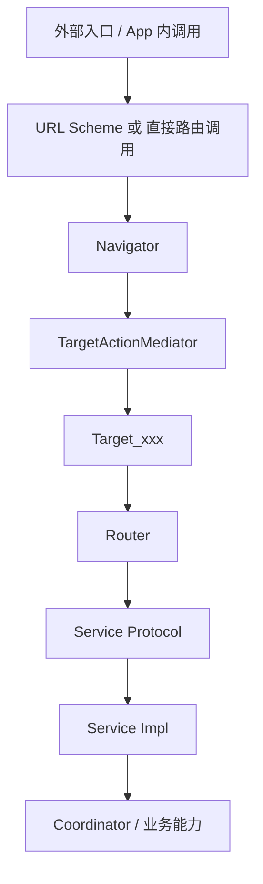
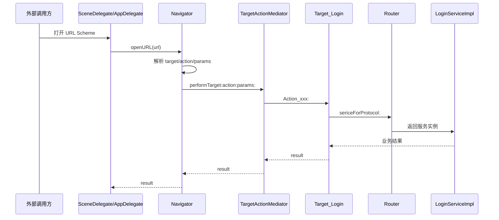

```markdown /Users/maochengfang/Documents/LLMProject/1009MultiModuleDemo/docs/模块间路由架构说明.md
# 模块间路由架构说明

## 1. 背景

为统一模块间通信方式、降低模块直接依赖、提升跨模块调用的可扩展性，项目自今日起新增一条明确的架构约束：

> 模块间通信统一走路由，并采用 `URL Scheme 路由 + Target-Action` 两种方式结合。

这意味着：

- 外部入口、动态入口、可配置入口统一走 `URL Scheme`
- 模块动作分发统一走 `Target-Action`
- 底层稳定能力继续由 `Protocol + Impl + Router` 提供
- 复杂业务编排继续由 `Coordinator` 负责收口

---

## 2. 设计目标

本架构的目标如下：

- 统一模块间调用入口
- 避免业务模块直接依赖实现类
- 支持外部 DeepLink / URL Scheme 扩展
- 支持模块动作的动态分发
- 保持底层服务能力的稳定接口
- 通过白名单和兜底机制提升安全性与可维护性

---

## 3. 总体架构



---

## 4. 分层职责

### 4.1 Navigator

`Navigator` 是统一路由入口，负责：

- 接收 `URL` 或直接调用请求
- 解析 Scheme、Target、Action、Query 参数
- 执行路由白名单校验
- 将请求转发给 `TargetActionMediator`

职责边界：

- 不直接承载业务逻辑
- 不直接依赖业务实现类
- 不负责复杂业务编排

---

### 4.2 TargetActionMediator

`TargetActionMediator` 是动作分发器，负责：

- 根据 `Target_xxx` 命名规则定位目标类
- 根据 `Action_xxx:` 命名规则定位动作方法
- 执行运行时消息分发
- 在 Action 缺失时尝试回退到 `Action_notFound:`

职责边界：

- 只负责“找到并执行”
- 不负责业务鉴权、业务状态管理
- 不应演变为业务逻辑中心

---

### 4.3 Target_xxx

`Target_xxx` 是模块动作适配层，负责：

- 承接模块对外暴露的动作入口
- 对 URL 参数进行转换、兼容与默认值处理
- 调用项目内部稳定服务能力
- 返回统一结果对象

典型特征：

- 类名示例：`Target_Login`
- 方法名示例：`Action_isLoggedIn:`
- 兜底方法示例：`Action_notFound:`

职责边界：

- 适合作为薄适配层
- 不适合承载复杂业务状态
- 不应直接替代 Service/Coordinator

---

### 4.4 Router

`Router` 是项目内已有的协议服务路由器，负责：

- 维护 `Protocol -> Class` 注册表
- 根据协议返回对应实现实例
- 支持共享服务单例能力

它的本质不是 `Target-Action`，而是：

- `Protocol-based Service Locator`
- 或轻量级 `DI / IoC` 容器

职责边界：

- 负责稳定服务发现
- 不负责动态入口解析
- 不负责 URL 分发

---

### 4.5 Service Protocol / Impl

服务层继续保持：

- `Protocol` 暴露稳定能力
- `Impl` 提供具体实现
- `Router` 负责定位实例

适用场景：

- 登录服务
- 网络服务
- 蓝牙服务
- iBeacon 服务
- 遥测服务

---

### 4.6 Coordinator

协调器用于跨服务编排，负责：

- 管理复杂状态流转
- 编排多个 Service 协作
- 做统一状态收口

适用场景：

- Beacon + BLE 联动
- 自动连接策略
- 解锁流程编排
- 遥测状态埋点

---

## 5. 两种路由方式的协同关系

### 5.1 URL Scheme 路由

用于：

- 外部入口
- DeepLink
- 调试入口
- 可配置动态入口

示例：

```text
multimoduledemo://Login/isLoggedIn
multimoduledemo://Login/loginInfo?phone=13800138000
```

路由解析规则：

- Scheme：`multimoduledemo`
- Host：Target 名称，例如 `Login`
- Path：Action 名称，例如 `loginInfo`
- Query：参数字典

---

### 5.2 Target-Action

用于：

- 模块动作分发
- App 内统一动态调用
- 将动态入口转为稳定模块动作调用

命名约定：

- Target 类：`Target_Login`
- Action 方法：`Action_loginInfo:`
- 兜底方法：`Action_notFound:`

---

### 5.3 两者如何结合

统一链路如下：



---

## 6. 当前项目中的落地方式

### 6.1 当前推荐调用链

- 外部入口：`SceneDelegate`
- URL 分发：`Navigator`
- 动作分发：`TargetActionMediator`
- 模块适配：`Target_Login`
- 服务定位：`Router`
- 服务实现：`LoginServiceImpl`

---

### 6.2 当前已约定的开放路由

当前建议通过白名单显式开放路由，例如：

- `Login/isLoggedIn`
- `Login/loginInfo`

说明：

- 未进入白名单的 URL 路由，不允许从外部入口触发
- 白名单用于控制暴露面，避免任意 Target/Action 被调用

---

## 7. 设计原则

### 7.1 入口层动态，能力层静态

- `URL Scheme` 和 `Target-Action` 负责动态入口
- `Service Protocol` 负责静态稳定能力

### 7.2 Target 做薄层适配

- 处理参数兼容、默认值、防御式校验
- 不承载复杂业务逻辑

### 7.3 Service 做稳定能力输出

- Service 面向内部核心能力
- Target 面向跨模块动作暴露

### 7.4 Coordinator 做复杂编排

- 多服务协同由 Coordinator 统一收口
- 避免将编排逻辑散落在 Target 中

### 7.5 外部入口必须受控

- URL 路由必须走 Scheme 校验
- Target/Action 必须走白名单控制
- 动作找不到时必须可兜底

---

## 8. 推荐目录结构

```text
1009MultiModuleDemo/
├── Navigator/
│   ├── Navigator.h
│   └── Navigator.m
├── TargetActor/
│   ├── TargetActionMediator.h
│   ├── TargetActionMediator.m
│   ├── Target_Login.h
│   └── Target_Login.m
├── Router/
│   ├── Router.h
│   ├── Router.m
│   └── SharedServiceProvider.h
├── LoginModule/
│   ├── LoginService.h
│   ├── LoginServiceImpl.h
│   └── LoginServiceImpl.m
```

---

## 9. 示例

### 9.1 URL Scheme 调用

```text
multimoduledemo://Login/loginInfo?phone=13800138000
```

### 9.2 直接调用 Navigator

```objective-c
id result = [Navigator performTarget:@"Login"
                              action:@"loginInfo"
                              params:@{@"phone": @"13800138000"}];
```

### 9.3 Target 内部调用 Service

```objective-c
id<LoginService> loginService = [[Router shared] sericeForProtocol:@protocol(LoginService)];
BOOL loggedIn = [loginService isLoggedIn];
```

---

## 10. 兜底与安全策略

### 10.1 路由白名单

用于控制哪些路由允许被 URL Scheme 打开。

示例策略：

- 允许：`Login/isLoggedIn`
- 允许：`Login/loginInfo`
- 禁止：未注册或未显式开放的 Target/Action

### 10.2 Target 不存在

统一返回：

- `target_not_found`

### 10.3 Action 不存在

优先回退：

- `Action_notFound:`

若未实现，则统一返回：

- `action_not_found`

### 10.4 参数防御

Target 层建议统一做：

- 空参数兼容
- 默认值补全
- 非法值过滤
- 鉴权前置

---

## 11. 适用场景与边界

### 11.1 适合走 URL Scheme + Target-Action

- DeepLink
- 运营活动入口
- 调试入口
- 跨模块离散动作调用
- 页面跳转入口

### 11.2 不建议直接暴露为 URL 路由

- 底层网络能力
- 蓝牙底层能力
- 遥测底层能力
- 涉及高风险系统权限操作的内部服务

这些能力更适合作为内部 Service，由 Target 或 Coordinator 间接调用。

---

## 12. 后续演进建议

### 第一阶段：最小可用

- 完成 URL Scheme 接入
- 完成 `Navigator`
- 完成 `TargetActionMediator`
- 完成白名单与兜底

### 第二阶段：能力闭环

- 为 `Target_Login` 增加 `Action_loginWithPhone:`
- 将 `LoginServiceImpl` 接入 `NetworkService`
- 完成真实登录链路

### 第三阶段：工程化增强

- 支持 Target 缓存
- 支持页面返回 `UIViewController`
- 支持更细粒度白名单
- 支持统一遥测埋点
- 支持路由鉴权与灰度控制

---

## 13. 总结

本项目当前采用的是一套组合式路由架构：

- `URL Scheme` 解决入口统一问题
- `Target-Action` 解决动作分发问题
- `Protocol + Impl + Router` 解决稳定服务能力治理问题
- `Coordinator` 解决复杂流程编排问题

这套组合相比单一方案更适合当前工程：

- 既保留动态性
- 又保留稳定性
- 同时兼顾扩展性、解耦性与工程治理能力
```
